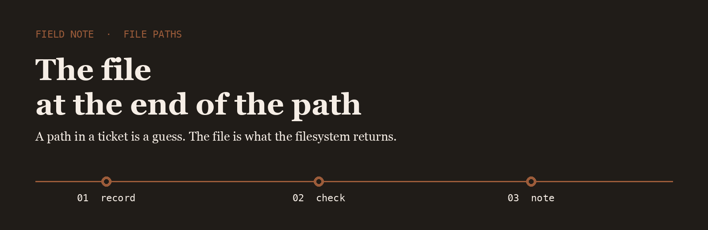
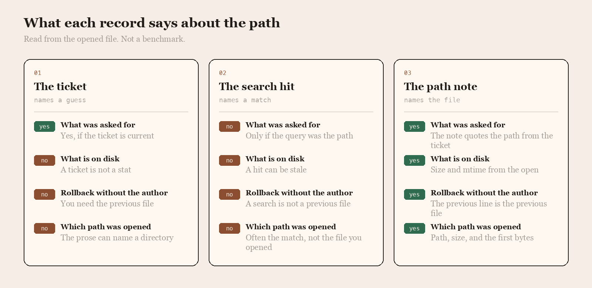

<p align="center">
  
</p>

# Path Rail

Path Rail is the name I use when a script names a path and the file at that path is a different size than anyone expected.

## The question

People trust the ticket, the search hit, or a note taken from the file that was opened. I asked which of those tells you what is on disk.

<p align="center">
  
</p>

|  | The ticket | The search hit | The path note |
| --- | --- | --- | --- |
| What was asked for | Yes, if the ticket is current | Only if the query was the path | The note quotes the path from the ticket |
| What is on disk | A ticket is not a stat | A hit can be stale | Size and mtime from the open |
| Rollback without the author | You need the previous file | A search is not a previous file | The previous line is the previous file |
| Which path was opened | The prose can name a directory | Often the match, not the file you opened | Path, size, and the first bytes |

## The line I keep

One line, written after the file is opened. The rollback is the previous line.

```text
2026-04-07T09:41:18Z  open  ops/edge/routes.txt  18432  mtime 2026-04-07T09:40:02Z
```

Search tools already know how to find a name. The gap is a line that says which file was opened, written by someone who opened it.

- [fd](https://github.com/sharkdp/fd) finds the path before I trust a ticket
- [ripgrep](https://github.com/BurntSushi/ripgrep) reads the file once the path is real
- [fzf](https://github.com/junegunn/fzf) is how I pick one path out of a noisy tree

I keep a fork of each on this account.

## What I pay attention to

- A path copied from stat, not from a comment
- A size that matches the file that was opened
- A rollback that is the previous file, not a new search
- Tools small enough to read in one sitting

## Working with me

Send a short problem statement, a way to see it happen, and what done looks like. I am independent, remote, and usually around during the Dublin workday.
